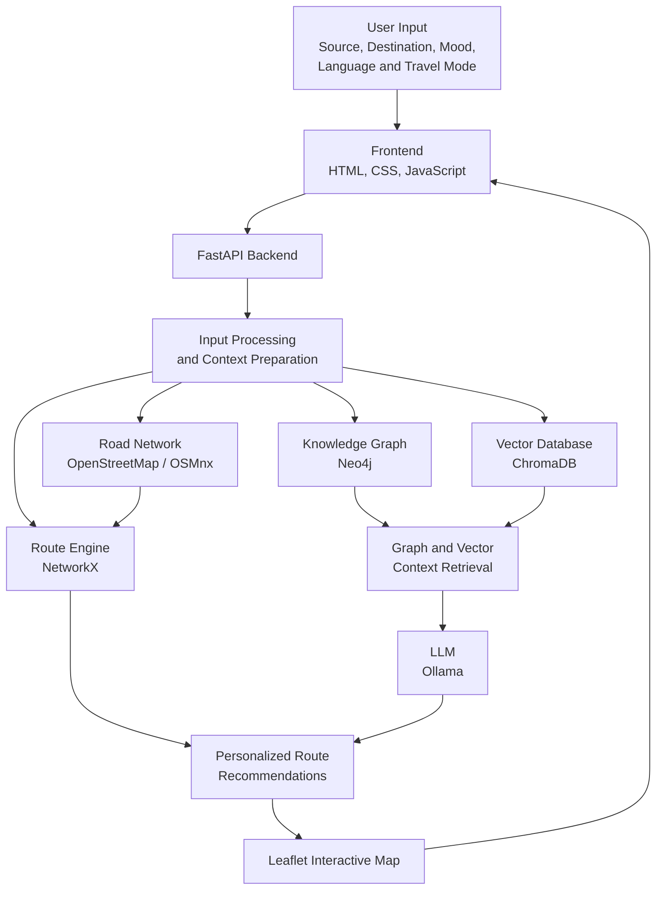
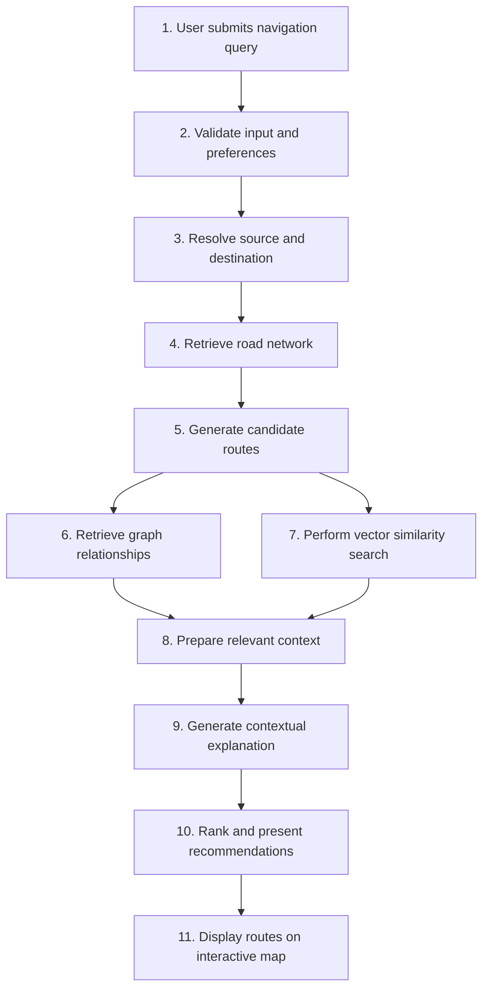

# 🗺️ Personalized Navigation Framework Using GraphRAG

**An AI-powered, multilingual, mood-based navigation system for personalized route recommendations across South Chennai.**

This project combines Graph Retrieval-Augmented Generation (GraphRAG), Large Language Models (LLMs), knowledge graphs, vector databases, and graph-based route optimization to provide context-aware navigation recommendations.

Users can enter their source and destination, select a travel mode and mood, and explore route recommendations based on available road network data, contextual information, preferences, and nearby points of interest.

---

## 📌 Table of Contents

- [Overview](#-overview)
- [Problem Statement](#-problem-statement)
- [Objectives](#-objectives)
- [Key Features](#-key-features)
- [System Architecture](#-system-architecture)
- [Architecture Flow](#-architecture-flow)
- [Project Workflow](#-project-workflow)
- [Technology Stack](#-technology-stack)
- [Project Structure](#-project-structure)
- [How GraphRAG Works](#-how-graphrag-works)
- [Routing Algorithms](#-routing-algorithms)
- [Installation and Setup](#-installation-and-setup)
- [Configuration](#-configuration)
- [Running the Application](#-running-the-application)
- [Example Usage](#-example-usage)
- [Applications](#-applications)
- [Future Enhancements](#-future-enhancements)
- [License](#-license)
- [Author](#-author)

## 📖 Overview

Traditional navigation systems primarily focus on finding the shortest or fastest route between two locations. However, different users may have different travel preferences depending on their mood, purpose, travel mode, and surrounding conditions.

The **Personalized Navigation Framework Using GraphRAG** explores a more context-aware approach by combining graph-based knowledge retrieval with vector similarity search and generative AI.

The framework uses a road network derived from OpenStreetMap, a Neo4j knowledge graph, a ChromaDB vector database, and an LLM served through Ollama. A FastAPI backend connects these components with an interactive web-based map.

The system is designed to support multiple travel modes, multilingual conversations, alternative routes, and recommendations for nearby facilities.

## ❗ Problem Statement

Conventional route planning often prioritizes distance or estimated travel time without fully considering individual preferences and contextual information.

A route that is shortest in distance may not always be the most suitable route for a particular user. Similarly, users may want a relaxed journey, a practical route, or opportunities to explore nearby places.

This project addresses these limitations by exploring how knowledge graphs, semantic retrieval, route optimization, and LLMs can work together to generate more personalized navigation recommendations.

## 🎯 Objectives

- Develop an AI-powered personalized navigation framework.
- Integrate GraphRAG with knowledge graph relationships and vector-based retrieval.
- Generate context-aware route recommendations using an LLM.
- Support mood-based and preference-based navigation.
- Explore multiple candidate routes using graph algorithms.
- Provide multilingual conversational interaction.
- Incorporate available information about weather, traffic, road safety, and nearby points of interest.
- Present recommendations through an interactive map interface.

## ✨ Key Features

### 🧠 GraphRAG-Based Information Retrieval

Combines graph-based relationships and vector similarity search to retrieve relevant information for navigation queries.

### 🛣️ Route Optimization

Uses graph-based pathfinding techniques to identify routes between source and destination locations.

### 😊 Mood-Based Personalization

Supports different travel preferences:

- **Calm:** Prioritizes a relaxed travel experience according to available route information.
- **Adventurous:** Encourages exploration and relevant nearby points of interest.
- **Efficient:** Focuses on practical route selection and travel efficiency.

### 🌐 Multilingual Chatbot

Supports conversational interaction in:

- English
- Tamil
- Telugu
- Hindi
- Kannada
- Malayalam
- Urdu

### 📍 Nearby Points of Interest

Supports discovery of useful nearby facilities, including:

- Petrol stations
- Restaurants
- Coffee shops
- Hospitals
- ATMs

### 🔀 Alternative Routes

Explores multiple possible paths using shortest-path and K-shortest-path algorithms.

### 🗺️ Interactive Map

Uses Leaflet.js and OpenStreetMap to display route information in a web-based map interface.

### 🌦️ Context-Aware Recommendations

The framework is designed to incorporate available contextual information such as weather, traffic conditions, road safety data, and user preferences. Recommendations depend on the data and integrations available at runtime.

---

## 🏗️ System Architecture

The framework consists of interconnected data, retrieval, routing, AI, backend, and presentation layers.



### Architecture Components

| Component | Responsibility |
|---|---|
| Frontend | Collects user inputs and displays navigation results. |
| FastAPI | Connects the frontend with backend services. |
| OpenStreetMap | Provides geographic and road network data. |
| OSMnx | Processes and analyzes road networks. |
| Neo4j | Stores and queries connected navigation entities and relationships. |
| ChromaDB | Stores embeddings and retrieves semantically relevant context. |
| NetworkX | Computes paths through a graph representation of the road network. |
| Ollama | Runs the configured language model locally. |
| Leaflet.js | Displays maps and route information. |

## 🔄 Architecture Flow

The following diagram illustrates how a navigation request moves through the system.



*Note: This is a conceptual flow. The exact execution order depends on the implementation of the backend.*

## 🔁 Project Workflow

1. **User interaction:** The user enters a source, destination, preferred language, travel mode, mood, and route preference.

2. **Location and road network processing:** The system uses available geographic data to represent roads and their connectivity.

3. **Route computation:** Graph algorithms identify candidate routes between the selected locations.

4. **Knowledge graph retrieval:** Neo4j provides relevant connected entities and relationships.

5. **Semantic retrieval:** ChromaDB searches for contextual documents using vector embeddings.

6. **Context preparation:** The retrieved information is combined with the navigation request and candidate routes.

7. **AI response generation:** The configured LLM generates a conversational explanation based on the supplied context.

8. **Result presentation:** The frontend presents route recommendations and available alternatives through the interactive map.

---

## 🛠️ Technology Stack

| Category | Technologies |
|---|---|
| Programming language | Python |
| Generative AI | Large Language Models, GraphRAG |
| Local model runtime | Ollama |
| Knowledge graph | Neo4j |
| Vector database | ChromaDB |
| Embeddings | Sentence Transformers, MiniLM |
| Backend API | FastAPI |
| Graph processing | NetworkX, OSMnx |
| Geographic data | OpenStreetMap |
| Map visualization | Leaflet.js |
| Frontend | HTML, CSS, JavaScript |
| Routing | Dijkstra's algorithm, Yen's K-shortest-path algorithm |
| External integrations | Weather and routing services, where configured |

## 📂 Project Structure

The following is a suggested repository organization. Retain your existing working filenames and directories when preparing the actual GitHub repository.

```text
graphrag-navigation/
│
├── README.md
├── LICENSE
├── .gitignore
├── requirements.txt
├── .env.example
│
├── backend/
│   ├── main.py
│   ├── config.py
│   │
│   ├── api/
│   │   ├── routes.py
│   │   └── chat.py
│   │
│   ├── graph/
│   │   ├── neo4j_client.py
│   │   ├── graph_builder.py
│   │   └── graph_retriever.py
│   │
│   ├── retrieval/
│   │   ├── vector_store.py
│   │   ├── embeddings.py
│   │   └── context_retriever.py
│   │
│   ├── navigation/
│   │   ├── route_engine.py
│   │   ├── pathfinding.py
│   │   └── poi_recommender.py
│   │
│   ├── llm/
│   │   └── ollama_client.py
│   │
│   └── data/
│       ├── road_network/
│       └── context_documents/
│
├── frontend/
│   ├── index.html
│   ├── style.css
│   └── script.js
│
├── tests/
│   ├── test_routes.py
│   ├── test_retrieval.py
│   └── test_navigation.py
│
└── docs/
    ├── architecture.md
    └── screenshots/
```

### Directory Description

- **`backend/`** — Contains the API and core application logic.
- **`api/`** — Handles navigation requests and chatbot communication.
- **`graph/`** — Manages Neo4j graph connections and graph retrieval.
- **`retrieval/`** — Handles embeddings, vector search, and context retrieval.
- **`navigation/`** — Contains pathfinding and route recommendation logic.
- **`llm/`** — Connects to the configured Ollama model.
- **`data/`** — Stores permitted local datasets and contextual documents.
- **`frontend/`** — Contains the interactive user interface.
- **`tests/`** — Holds automated tests.
- **`docs/`** — Contains diagrams, documentation, and screenshots.

Do not create empty folders just to match this example. Organize the files according to your actual implementation.

## 🧩 How GraphRAG Works

GraphRAG combines graph-structured information with retrieval-augmented generation to improve the context available to a language model.

### 1. Knowledge Graph

Navigation entities and their relationships can be represented as nodes and edges.

Example:

```text
Location: Adyar
    |
    | CONNECTED_TO
    v
Location: Besant Nagar
    |
    | NEARBY
    v
Point of Interest: Restaurant
```

Neo4j enables the system to query relationships between connected locations and relevant entities.

### 2. Vector-Based Retrieval

Textual information is converted into embeddings and stored in ChromaDB.

When a user submits a query, the system can retrieve semantically similar documents to provide additional context.

### 3. Context-Aware Generation

The retrieved graph information, relevant documents, and navigation results can be supplied to an LLM to generate a response grounded in the available information.

The objective is to combine structured relationships and semantic information instead of relying exclusively on a standalone language model.

## 🧭 Routing Algorithms

### Dijkstra's Algorithm

Finds a minimum-cost path in a weighted graph with non-negative edge weights. The meaning of the result depends on the chosen edge weights.

### Yen's K-Shortest-Path Algorithm

Can be used to identify multiple loopless candidate paths between two nodes, subject to the graph and implementation constraints.

### Route Personalization

Candidate routes can be evaluated against available user preferences, contextual data, and points of interest. A route should only be described as traffic-aware or safety-ranked when the implementation actually uses appropriate traffic or safety data.

---

## ⚙️ Installation and Setup

### Prerequisites

Install or configure the following components before running the application:

- Python 3.10 or another version supported by your dependencies
- Git
- Ollama and the language model used by your project
- Neo4j, with a configured database
- Required Python packages
- Geographic data and contextual documents used by the application

### Step 1: Clone the Repository

Open a terminal in VS Code or PowerShell and run:

```powershell
git clone https://github.com/sreepralaya26/graphrag-navigation.git
cd graphrag-navigation
```

Replace the repository URL if your actual GitHub repository uses a different name.

### Step 2: Create a Virtual Environment

```powershell
python -m venv venv
```

Activate it in Windows PowerShell:

```powershell
.\venv\Scripts\Activate.ps1
```

If activation is blocked by your system's execution policy, use an approved activation method or run the virtual environment's Python executable directly.

### Step 3: Install Dependencies

If `requirements.txt` is located in the repository root:

```powershell
pip install -r requirements.txt
```

If dependencies are maintained separately inside `backend/`, use the corresponding requirements file there instead.

### Step 4: Configure Ollama

Install Ollama and download the models required by your code.

For example, if your configuration uses these models:

```powershell
ollama pull llama3.2
ollama pull nomic-embed-text
```

Start the Ollama service if it is not already running:

```powershell
ollama serve
```

If Ollama is already running as a background service, you generally do not need to start a second instance.

Check the models available locally:

```powershell
ollama list
```

The configured model names must match the names used in your application.

### Step 5: Configure Neo4j

1. Start your Neo4j database.
2. Create or select the appropriate database.
3. Configure the connection URI, username, and password.
4. Ensure the application uses the same connection settings.

Do not commit database passwords or other secrets to GitHub.

### Step 6: Configure Environment Variables

Create a local `.env` file using your project's supported configuration names.

Example placeholders:

```env
NEO4J_URI=bolt://localhost:7687
NEO4J_USERNAME=neo4j
NEO4J_PASSWORD=your_local_password

OLLAMA_BASE_URL=http://localhost:11434
OLLAMA_MODEL=llama3.2
EMBEDDING_MODEL=nomic-embed-text
```

These are illustrative variable names. Your application must explicitly load and use them, and any additional service keys should be configured according to the relevant integration.

### Step 7: Prepare the Data

Make sure the required road network data, graph records, vector documents, and supporting files are available.

If the project already has a populated Neo4j graph and ChromaDB collection, configure the application to use those resources. Otherwise, run the project's data preparation and indexing scripts, if provided.

---

## ▶️ Running the Application

The following commands assume that the FastAPI entry point is `backend/main.py`.

### Start the Backend

From the repository root:

```powershell
python -m uvicorn backend.main:app --reload
```

If the actual entry point is `backend/main.py` and imports require running from inside the backend directory, use:

```powershell
cd backend
python -m uvicorn main:app --reload
```

Use the command that matches your actual package structure and imports.

### Open the API Documentation

Once the backend starts successfully, visit:

```text
http://127.0.0.1:8000/docs
```

This address assumes the application uses Uvicorn's default port and exposes FastAPI's documentation.

### Launch the Frontend

Open the frontend entry point through the method supported by your application. If it is a standalone HTML page, use a local development server or your configured frontend serving mechanism.

Ensure the frontend API URL matches the running backend.

---

## 💬 Example Usage

A sample navigation request could look like this:

| Input | Example |
|---|---|
| Source | Adyar |
| Destination | Elliot's Beach |
| Travel mode | Bike |
| Route preference | Fastest |
| Mood | Calm |
| Language | English |
| Nearby places | Coffee shops |

The application processes the selected inputs, computes candidate routes, retrieves available contextual information, and presents its recommendations through the navigation interface.

The resulting recommendations depend on the actual road network, configured services, and available data.

## 🧪 Testing

If automated tests are included in the repository, execute them with:

```powershell
python -m pytest
```

Recommended test areas include:

- Route computation between valid locations
- Handling of invalid or missing locations
- Graph database connectivity
- Vector retrieval and embedding configuration
- LLM availability and response handling
- Multilingual input processing
- API request validation
- Frontend and backend integration

## 🔐 Security and Data Handling

- Store credentials in environment variables, not source files.
- Exclude `.env`, virtual environments, caches, and generated secrets from Git.
- Validate and sanitize user input.
- Protect database credentials and external service API keys.
- Check third-party software and geographic data licenses before distribution.
- Avoid committing private user travel histories or sensitive location records.

## 🌍 Applications

Potential applications of this framework include:

- Personalized urban navigation
- Mood-aware trip planning
- Contextual route exploration
- Multilingual navigation assistance
- Nearby point-of-interest discovery
- Conversational travel recommendations
- Research into GraphRAG-based intelligent transportation systems

## 🔮 Future Enhancements

- Integrate reliable live traffic feeds.
- Improve route scoring with validated safety information.
- Add user feedback to refine personalized recommendations.
- Enhance route selection using historical preferences.
- Expand the supported geographic area.
- Add mobile-friendly navigation features.
- Evaluate retrieval relevance, route quality, and response accuracy.
- Compare graph-based retrieval with vector-only retrieval.

## 📄 License

This project is distributed under the MIT License. Refer to the [`LICENSE`](LICENSE) file for the complete license terms.

The MIT License applies to the project components for which the copyright holder has the right to grant that license. Third-party libraries, datasets, and other reused materials remain subject to their applicable terms.

## 👩‍💻 Author

**Sree Pralaya**

Computer Science and Engineering

GitHub: [@sreepralaya26](https://github.com/sreepralaya26)

---

*This project explores the integration of knowledge graphs, semantic retrieval, route optimization, and generative AI to support personalized, context-aware navigation.*
